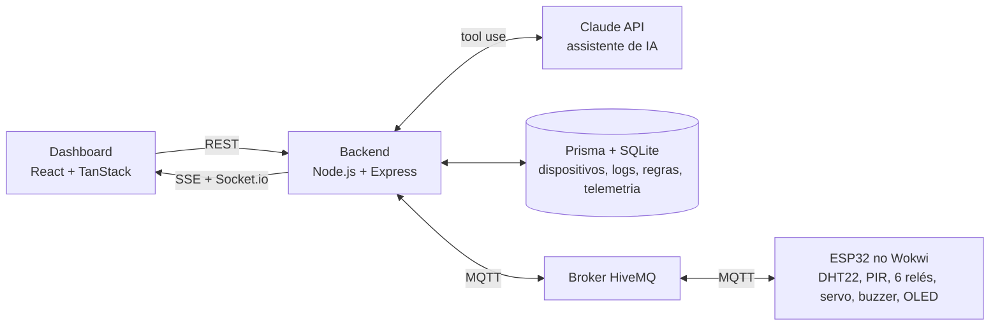

# Casa Inteligente: IoT com ESP32, MQTT e assistente de IA

Sistema de automação residencial com ESP32 simulado no Wokwi, backend em Node.js e dashboard web. Os dispositivos podem ser controlados por botões, por regras automáticas baseadas em sensores e por um assistente de IA que entende pedidos em linguagem natural e executa ações com tool use. O objetivo do projeto é mostrar como a automação reduz o desperdício de energia em casa.

Projeto acadêmico da disciplina UPx, Engenharia da Computação, FACENS (abril a junho de 2026).

## O que o sistema faz

- **Dashboard em tempo real:** temperatura, umidade, movimento, porta e alarme, com 6 dispositivos em 3 cômodos (luzes, ventilador, ar-condicionado e cafeteira)
- **Assistente de IA ("Cláudio"):** conversa em português e usa ferramentas para ligar e desligar dispositivos, controlar um cômodo inteiro, agendar ações, abrir e fechar a porta, armar o alarme e consultar o estado da casa
- **Automações:** regras criadas pela interface, com gatilhos como "temperatura > 28 °C" ou "umidade >= 80%" e uma ação em um dispositivo, com intervalo mínimo de 60 segundos entre disparos
- **Segurança no próprio ESP32:** alarme de intruso pelo sensor de movimento e alerta de calor extremo pelo buzzer
- **Histórico:** registro de cada acionamento e gráficos de telemetria por período (1 h, 6 h, 24 h e 7 dias)

## Arquitetura



| Camada | Tecnologia |
| --- | --- |
| Microcontrolador | ESP32 com PlatformIO, simulado no Wokwi |
| Comunicação IoT | MQTT (broker público HiveMQ), tópicos `upx2025/casa/...` |
| Backend | Node.js, Express, Prisma (SQLite), Socket.io e SSE |
| IA | Claude (Anthropic SDK), com 7 ferramentas (tool use) |
| Frontend | React com TanStack Router e Query, Tailwind |

## Como o assistente de IA funciona

O backend envia a mensagem do usuário ao Claude junto com a lista de ferramentas disponíveis. O modelo decide qual ferramenta chamar, o backend executa a ação (publica o comando no MQTT e atualiza o banco) e devolve o resultado para o modelo responder em linguagem natural.

| Ferramenta | O que faz |
| --- | --- |
| `control_device` | Liga ou desliga um dispositivo |
| `control_all_devices` | Liga ou desliga todos |
| `control_room` | Liga ou desliga um cômodo inteiro |
| `schedule_action` | Agenda uma ação por atraso ou horário |
| `control_alarm` | Arma ou desarma o alarme |
| `control_door` | Abre ou fecha a porta |
| `get_status` | Consulta o estado atual da casa |

## Como rodar

Pré-requisitos: Node.js 20, VS Code com as extensões PlatformIO IDE e Wokwi Simulator, e uma chave da API da Anthropic (só para o chat).

**1. Backend**

```bash
git clone https://github.com/rafuulll/projeto-casa-inteligente-upx.git
cd projeto-casa-inteligente-upx/backend
cp .env.example .env
```

No `.env`, use o banco SQLite local e preencha a chave:

```env
DATABASE_URL="file:./dev.db"
MQTT_BROKER="mqtt://broker.hivemq.com:1883"
PORT=3001
ANTHROPIC_API_KEY="sua_chave"
```

```bash
npm install
npx prisma generate
npm start
```

O backend sobe em http://localhost:3001 e cria os dispositivos e as regras de exemplo na primeira execução. Sem a chave da Anthropic, só o chat fica indisponível.

**2. Frontend**

```bash
cd ../frontend
npm install
npm run dev
```

Acesse http://localhost:5173.

**3. ESP32 no Wokwi**

1. Abra a pasta `esp32/` no VS Code (o PlatformIO só reconhece o projeto abrindo essa pasta).
2. Rode `PlatformIO: Build` e espere o `SUCCESS`.
3. Rode `Wokwi: Start Simulator`. O ESP32 conecta no Wi-Fi do Wokwi e no broker HiveMQ.

## Limitações conhecidas

- O `docker-compose.yml` ainda aponta para PostgreSQL, enquanto o Prisma usa SQLite. Por enquanto, rode localmente como descrito acima.
- As regras com gatilho de movimento são salvas, mas o backend só avalia regras quando chegam temperatura ou umidade. O alarme de intruso funciona pelo próprio ESP32.
- Não há medição real de consumo. A economia de energia apresentada é uma estimativa por potência e tempo ligado (cerca de 48 kWh e R$ 45 por mês no cenário da equipe).
- O broker MQTT é público e sem autenticação, adequado só para simulação.

## Próximos passos

- Avaliar regras de movimento no backend e unificar SSE e Socket.io em um único canal
- Corrigir o Docker Compose para subir tudo com um comando
- Integração com WhatsApp e automações por horário

## Equipe

Projeto em equipe da disciplina UPx. Contribuidores no GitHub: Murilo Oliveira e Rafael Maschietto.
